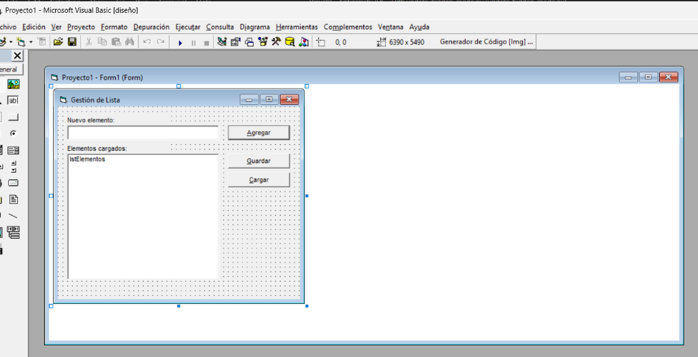

<div align="center">

# Visual Basic 6.0 Pro + Inteligencia Artificial

**Entorno portable de Microsoft Visual Basic 6.0 con integración nativa de Inteligencia Artificial en el IDE.**


<br/>



</div>

---

## ¿Qué incluye este repositorio?

Un instalador completo y portable de **Microsoft Visual Basic 6.0** junto con un complemento nativo de **Inteligencia Artificial** integrado directamente en la barra de herramientas del IDE para crear y modificar formularios, controles visuales y lógica en tiempo real.

---

## Características Principales

| Característica | Descripción |
| :--- | :--- |
| **Botón nativo en el IDE** | Icono integrado en la barra estándar de Visual Basic 6.0 sin ventanas molestas ni modales innecesarios. |
| **Ejecución silenciosa** | Corre en segundo plano sin abrir consolas CMD encima del editor; muestra el progreso en vivo al apoyar el mouse (`TooltipText`). |
| **Recarga en tiempo real** | Los formularios (`.frm`), módulos (`.bas`) y clases (`.cls`) nuevos o modificados se actualizan en pantalla al instante sin cerrar el proyecto. |
| **Compatibilidad VB6 estricta** | Conversión automática a codificación **ANSI (Windows-1252)** y saltos de línea **CRLF (`\r\n`)** para evitar errores de carga en el diseñador. |
| **Lectura de capturas de pantalla** | Detecta imágenes en el portapapeles (con confirmación **Sí / No**) para replicar interfaces visuales automáticamente. |
| **Estándares de código VB6** | `Option Explicit` obligatorio, tipado estricto, limpieza de memoria (`Set obj = Nothing`, `Unload Me`, `Erase`, `Close #n`), archivos `Random`/`Input`/`Output`/`Append`, `MSFlexGrid`, `MDI` y objeto `Printer`. |

---

## Stack Tecnológico

* **IDE / Runtime:** Microsoft Visual Basic 6.0 (COM / `VBIDE` Extensibility)
* **Motor de Inteligencia Artificial:** Antigravity CLI (`agy`) con ejecución automática
* **Automatización y Conversión:** Python 3 + Pillow (`ImageGrab`)
* **Instalación y Registro:** Batch + PowerShell (`regsvr32`, `vbaddin.ini`, Registro de Windows)

---

## Estructura del Repositorio

```text
VisualBasic6Pro/
├── assets/
│   └── preview.png               # Vista previa del entorno en funcionamiento
├── Complemento_VB6/              # Addin.dll, scripts de soporte y skill de VB6
├── Microsoft Visual Basic 6.0/   # Instalador original de Visual Basic 6.0
├── Instalar_Generador_VB6.bat    # Instalador automático del complemento y dependencias
└── README.md
```

---

## Instalación en cualquier PC

1. **Clonar el repositorio**
   ```cmd
   git clone https://github.com/Rax0r-cmd/VisualBasic6Pro.git
   ```

2. **Instalar Visual Basic 6.0**
   Ejecuta `Microsoft Visual Basic 6.0\setup.exe` e instala Visual Basic 6.0 por tu cuenta (si aún no está instalado en la PC).

3. **Instalar el complemento de Inteligencia Artificial**
   Ejecuta **`Instalar_Generador_VB6.bat`**. El instalador realiza todo de forma automática y dinámica para el usuario actual:
   * Copia el complemento y la skill de VB6 en `%LOCALAPPDATA%` y `%USERPROFILE%`.
   * Registra `Addin.dll` (compatible con Windows de 32 y 64 bits) y lo habilita en `vbaddin.ini` y en el Registro de Windows.
   * Configura el modo de ejecución automática sin interrupciones.
   * Verifica e instala **Python 3** (+ `Pillow`) y **Antigravity CLI (`agy`)** si no están presentes en la PC.

4. **Primer inicio en una PC nueva**
   Si `agy` se instaló por primera vez en esa computadora, abre una terminal, ejecuta `agy` e inicia sesión una única vez.

---

## Uso rápido dentro de VB6

* **Prompt directo:** Haz clic en el icono de Inteligencia Artificial en la barra superior para escribir tu pedido (o ubica el cursor sobre un comentario `' ...` en el código y haz clic en el icono).
* **Con captura de referencia:** Toma una captura con `Win + Shift + S`, haz clic en el icono y confirma **Sí** cuando te pregunte si deseas adjuntarla.
* **Si se requiere confirmación:** El icono mostrará `[?]` a su lado; haz clic para responder y continuará trabajando en segundo plano.
